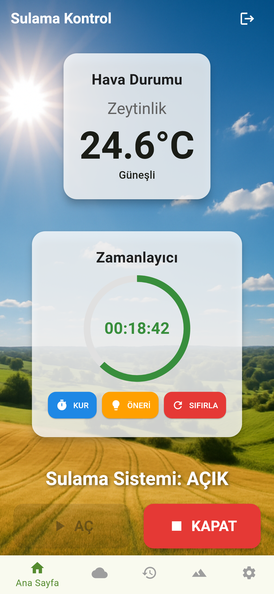
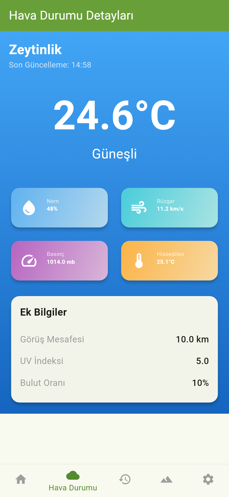
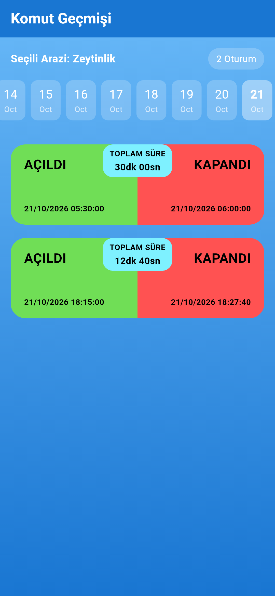
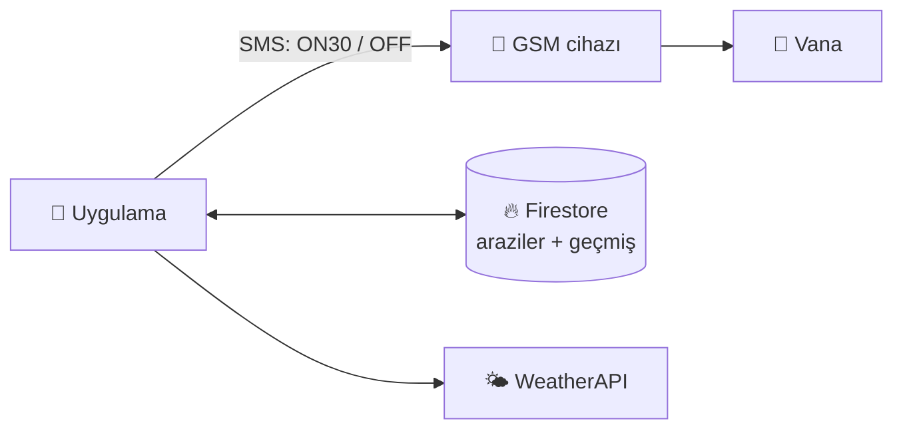

# TopTech — Uzaktan Sulama Kontrolü

Tarladaki GSM modüllü sulama cihazını SMS ile açıp kapatan, sulama geçmişini Firebase Firestore'da tutan Flutter uygulaması.

<p align="center">
  
  
  
</p>



Ekranlar, çalışma mantığı, kurulum (`.env`) ve test sonuçları için: **[irrigation_control_app/README.md](irrigation_control_app/README.md)**

```bash
cd irrigation_control_app
cp .env.example .env        # WEATHER_API_KEY=...
flutter pub get
flutter run --dart-define-from-file=.env
flutter test                # 53 test
```
