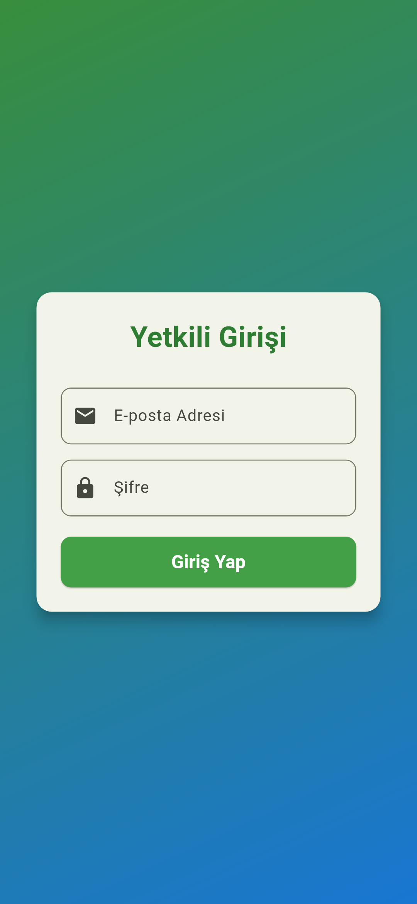
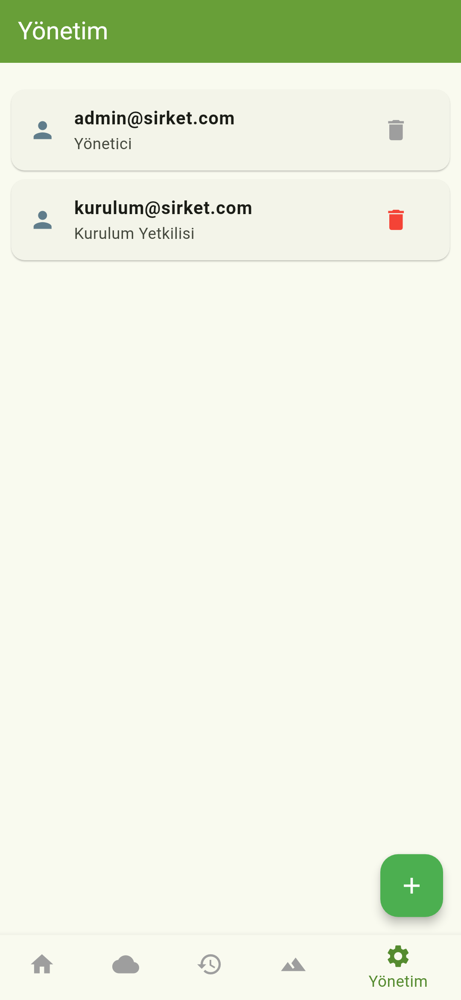
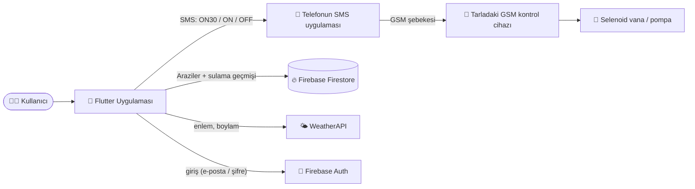
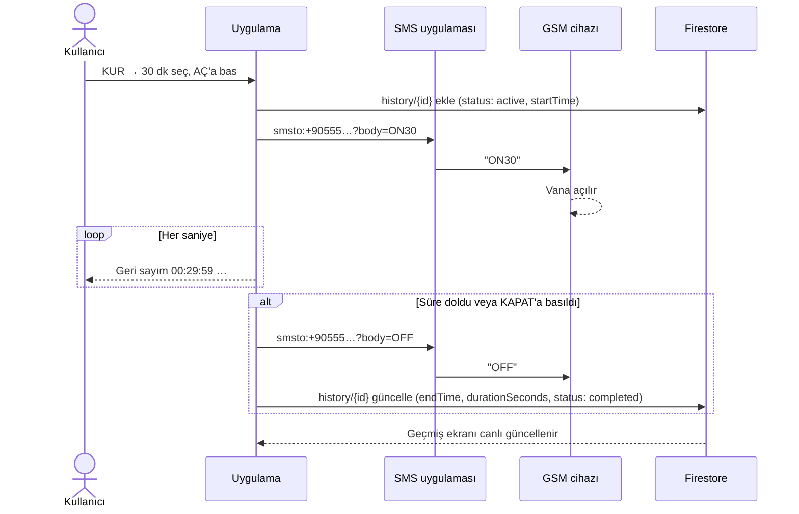
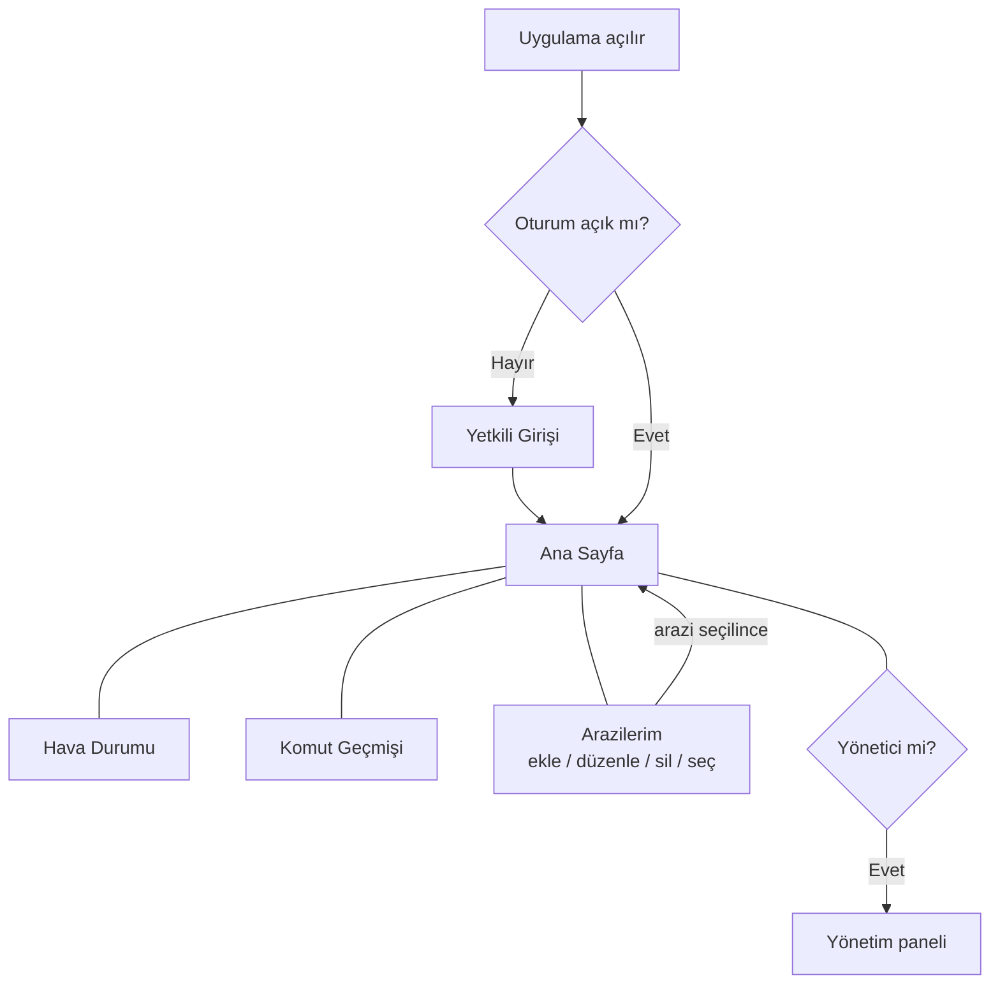

# 💧 Sulama Kontrol Uygulaması

Tarladaki **GSM modüllü sulama kontrol cihazını SMS komutlarıyla** yöneten Flutter uygulaması. Sahada internet olmasa bile telefonun SMS uygulaması üzerinden vanayı açar/kapatır; sulama geçmişini ve arazileri **Firebase Firestore**'da saklar, seçili arazinin hava durumunu gösterir.

<p align="center">
  
  
  
  
  
</p>

---

## 📱 Ekranlar ve ne yaptıkları

| Ekran | Görünüm | Ne yapar? |
|---|:-:|---|
| **Yetkili Girişi** |  | **Firebase Authentication** ile giriş. Sadece yöneticinin yetkilendirdiği hesaplar girebilir; parolalar uygulamada veya telefonda saklanmaz. Oturum açık kalır; erişimi kaldırılan hesabın oturumu bir sonraki açılışta kapanır. |
| **Ana Sayfa** |  | Seçili arazinin anlık hava durumu (arka plan hava durumuna ve gündüz/geceye göre değişir). **KUR** ile süre seçilir, **ÖNERİ** 30 dk önerir, **SIFIRLA** süreyi temizler. **AÇ** cihaza `ON<dakika>` (süre yoksa `ON`), **KAPAT** `OFF` SMS'i gönderir. Süre dolunca sulama kendiliğinden kapanır. |
| **Hava Durumu** |  | Arazinin koordinatlarına göre sıcaklık, nem, rüzgâr, basınç, hissedilen sıcaklık, görüş, UV ve bulut oranı (WeatherAPI). |
| **Komut Geçmişi** |  | Seçili arazinin, seçilen güne ait sulama oturumları: açılış/kapanış zamanı ve toplam süre. Kayıtlar Firestore'dan canlı okunur. |
| **Yönetim** |  | Sadece **yönetici** rolündeki hesaplar görür. Yeni kurulum yetkilisi ekler (Firebase hesabı oluşturulur) veya erişimini kaldırır; yönetici hesapları ve oturumu açık kullanıcı kaldırılamaz. |

---

## ⚙️ Nasıl çalışır?

### Genel mimari



### Bir sulama oturumu



### Ekran akışı



### Firestore veri yapısı

```
artifacts/remote-irrigation-app/
├── authorized_users/{uid}                ← uygulamayı kullanabilecek hesaplar
│     email, role ("admin" | "installer"), active
└── users/{uid}/                          ← Firebase Auth kullanıcı kimliği; sadece sahibi erişir
├── lands/{arazi_id}
│     name, phoneNumber, latitude, longitude, createdAt
└── history/{oturum_id}
      landId, landName, startTime, endTime, durationSeconds, status ("active" | "completed")
```

### SMS komutları

| Komut | Ne zaman | Anlamı |
|---|---|---|
| `ON30` | Süre seçiliyken AÇ | 30 dakika sula, sonra kendiliğinden kapan |
| `ON` | Süre seçilmeden AÇ | Süresiz sula (KAPAT'a kadar) |
| `OFF` | KAPAT veya süre bittiğinde | Sulamayı durdur |

---

## 🚀 Kurulum ve çalıştırma

1. Bağımlılıkları yükleyin:
   ```bash
   flutter pub get
   ```
2. Hava durumu anahtarı için `.env` dosyası oluşturun (bu dosya **git'e eklenmez**, `.gitignore`'dadır):
   ```bash
   cp .env.example .env
   # .env içine: WEATHER_API_KEY=<weatherapi.com anahtarınız>
   ```
3. Uygulamayı `.env` ile çalıştırın:
   ```bash
   flutter run --dart-define-from-file=.env
   flutter build apk --dart-define-from-file=.env
   ```
   VS Code'da kök klasördeki `.vscode/launch.json` bu parametreyi otomatik verir. Anahtar verilmezse ana ekranda hava durumu yerine uyarı mesajı görünür; sulama kontrolü yine çalışır.

4. **İlk yöneticiyi oluşturun** (bir kez):
   1. Firebase konsolu → **Authentication** → Sign-in method: **E-posta/Şifre** açık olsun → Users → **Add user** ile yönetici e-postası ve şifresini ekleyin, oluşan **User UID**'yi kopyalayın.
   2. **Firestore** → `artifacts/remote-irrigation-app/authorized_users/{User UID}` belgesini oluşturun: `email` (string, küçük harf), `role` = `"admin"`, `active` = `true`.
   3. Diğer kurulum yetkililerini uygulamadaki **Yönetim** sayfasından ekleyin.
5. Güvenlik kurallarını yayınlayın: depo kökündeki `firestore.rules` ve `storage.rules` (bkz. [Güvenlik](#-güvenlik)).

> ⚠️ Eski WeatherAPI anahtarı daha önce `lib/main.dart` içinde git'e gönderilmişti. Kaynaktan kaldırıldı, ancak git geçmişinde hâlâ duruyor; **weatherapi.com panelinden anahtarı yenileyip** yenisini `.env`'e yazın.

---

## 🔐 Güvenlik

- **Giriş:** Firebase Authentication. Eski sürümdeki sabit parolalar (`admin@sirket.com` / `sifre123` vb.) kaldırıldı; bu parolalar git geçmişinde ve eski APK'larda göründüğü için **artık hiçbir işe yaramaz**.
- **Yetki:** Bir hesabın uygulamayı kullanabilmesi için `authorized_users/{uid}` belgesinde `active: true` olmalı. Firebase'de kendi kendine hesap açan biri listede olmadığından hiçbir veriyi göremez. Erişimi kaldırılan hesap (`active: false`) veri göremez ve oturumu kapanır.
- **Veri ayrımı:** Her kullanıcının arazileri (GSM numaraları, konumlar) ve sulama geçmişi kendi uid'si altında tutulur; başka bir kullanıcı (yönetici dahil) okuyamaz.
- **Kurallar:** Firebase projesi (`toptech-717ee`) web uygulamasıyla (TopTech_Operation_Green) ortaktır. `firestore.rules` ve `storage.rules` iki repoda **aynıdır**; kural testleri TopTech_Operation_Green reposunda `npm run test:rules` ile çalıştırılır (12/12 ✅).
  ```bash
  firebase deploy --only firestore:rules,storage   # depo kökünden
  ```
- **SMS cihazı:** Cihaz `ON`/`OFF` komutlarını SMS ile aldığı için, numarayı bilen herkes komut gönderebilir. Cihaz yazılımı destekliyorsa sadece kayıtlı telefon numaralarından gelen komutları kabul edecek şekilde (beyaz liste / PIN) ayarlanması önerilir.

---

## 🧪 Testler ve doğrulama sonuçları

```bash
flutter test
```

UI ve Firebase'den bağımsız iş kuralları (SMS komutları, koordinat dönüştürme, Firestore yolları, süre biçimleri, WeatherAPI isteği) `lib/irrigation_logic.dart` içindedir. Firestore servisleri testlerde [`fake_cloud_firestore`](https://pub.dev/packages/fake_cloud_firestore) ile gerçek bağlantı olmadan doğrulanır.

### Son çalıştırma sonucu

> 22 Ekim 2026 · Flutter 3.47.7 (stable) · Dart 3.13.5 — **5 dosya, 58 test, 58 başarılı ✅, 0 başarısız**

| Test dosyası | Test | Sonuç | Doğrulanan davranış |
|---|:-:|:-:|---|
| `test/irrigation_logic_test.dart` | 17 | ✅ | `ON<dakika>` / `ON` / `OFF` komutları, `smsto:` URI'si ve URL kodlaması, WeatherAPI isteği, Firestore yolları, gündüz/gece arka planı, virgüllü koordinatlar, süre biçimleri |
| `test/firestore_services_test.dart` | 7 | ✅ | Verilerin kullanıcının uid'si altında tutulması; sulama başlayınca oturumun `active` kaydı, bitince `endTime` + `durationSeconds` + `completed`, uygulama yeniden açıldığında geçmişin en yeniden eskiye okunması, kullanıcı bazlı ayrım, arazi ekle/listele/güncelle/sil |
| `test/auth_service_test.dart` | 14 | ✅ | Firebase ile giriş, yanlış şifre (hangi bilginin yanlış olduğu söylenmeden), Firebase hesabı olup yetkili listesinde olmayan veya pasifleştirilmiş hesabın reddi, oturum açıkken erişimi kaldırılanın çıkarılması, yönetici rolü, kullanıcı ekleme/yeniden etkinleştirme/kaldırma, parolanın hiçbir yerde saklanmaması |
| `test/models_test.dart` | 4 | ✅ | `Land` modelinin Firestore'dan okunması, `IrrigationSession` süre hesabı |
| `test/widgets_test.dart` | 16 | ✅ | Giriş ekranı akışı (yetkisiz hesabın reddi dahil), yönetim paneli, geçmişin araziye/güne göre filtrelenmesi, hava durumu detayları, ana ekranda AÇ/KAPAT, geri sayım, ÖNERİ, SIFIRLA |

### Testlerle bulunan ve düzeltilen hatalar

| # | Bulgu | Durum |
|---|---|---|
| 1 | İlk kurulumda kullanıcı ekleme/silme "Cannot modify unmodifiable map" hatasıyla çöküyordu (`AuthService` sabit haritayı döndürüyordu). | ✅ Düzeltildi |
| 2 | Sulama geçmişi Firestore'a kaydedilmiyordu: `history_service.dart` derlenmiyordu ve hiç kullanılmıyordu, geçmiş uygulama kapanınca kayboluyordu. | ✅ Düzeltildi — oturumlar başlangıçta kaydedilip bitişte güncelleniyor, geçmiş ekranı Firestore'dan canlı okuyor |
| 3 | Araziler ve geçmiş farklı Firestore köklerine yazılıyordu. | ✅ Düzeltildi — ikisi de `artifacts/remote-irrigation-app/users/{id}/` altında |
| 4 | WeatherAPI anahtarı kaynak kodda açıktı. | ✅ `.env` + `--dart-define-from-file` (anahtarın yenilenmesi önerilir) |
| 5 | Hava durumu ekranında rüzgâr hızı `km/s` yazıyor (`km/sa` olmalı). | ⚠️ Kozmetik, açık |
| 6 | **Güvenlik:** Parolalar kaynak kodda ve telefonda düz metin olarak duruyordu; Firestore'a oturumsuz erişildiği için veritabanının herkese açık olması gerekiyordu. | ✅ Firebase Authentication + yetkili listesi + kullanıcı bazlı kurallar |

> Not: **KUR** butonu yazılım tarafında çalışıyor (saat/dakika seçici açılıyor). Sahadaki devrede arızalı bir bileşen değiştirilene kadar cihaz tarafında süreli çalışma beklemede.

### Test kapsamı dışında kalanlar

`MainScreen` ve `MyLandsPage` doğrudan Firebase'e bağlandığı için widget testinde açılamıyor; bu ekranların akışı servis testleri üzerinden doğrulandı. Telefonda SMS uygulamasının gerçekten açılması, mesajın cihaza ulaşması, canlı WeatherAPI yanıtı ve yerel bildirimler gerçek cihazda manuel test edilmelidir.

### Ekran görüntülerini yeniden üretmek

README'deki görseller uygulamanın gerçek widget'ları (gerçek Roboto fontu ve asset'lerle) çizilerek üretilir:

```bash
flutter test tool/screenshots_test.dart --update-goldens   # → docs/screenshots/*.png
```
